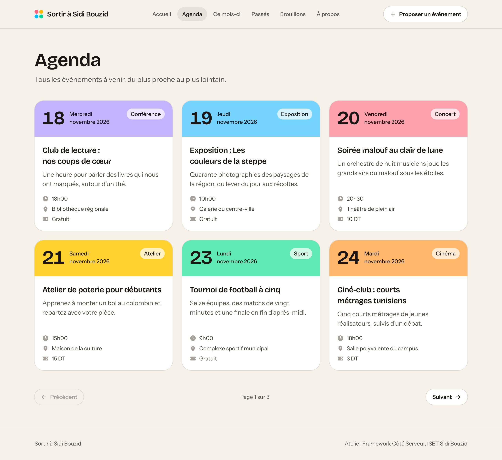
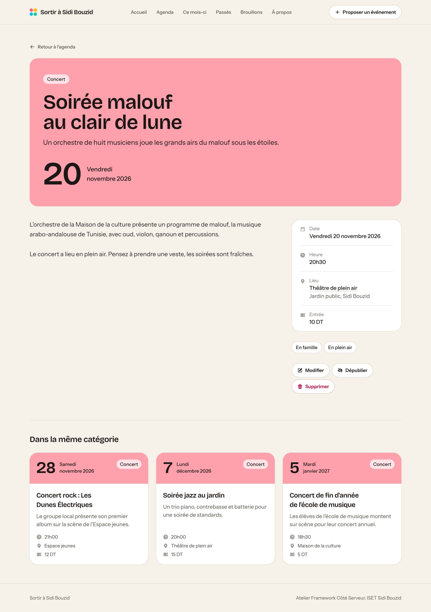
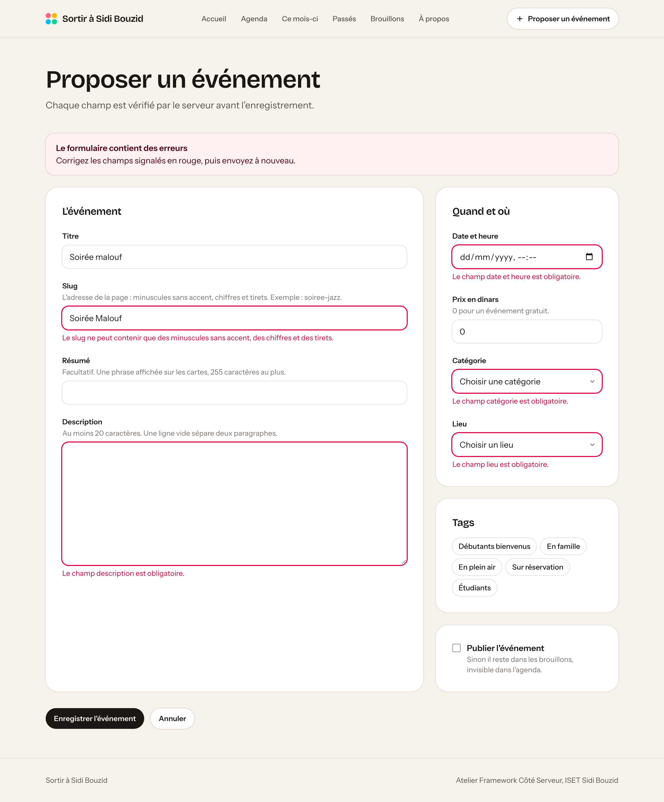
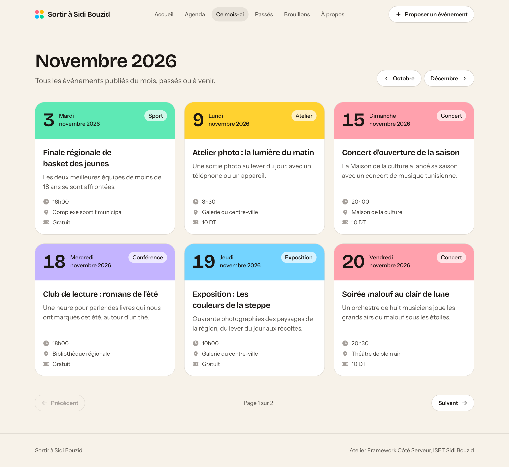

# Sortir à Sidi Bouzid

Un agenda des sorties de Sidi Bouzid : concerts, ateliers, sport, expositions, conférences et cinéma. On parcourt les événements par date, par catégorie, par lieu ou par tag, et on peut en proposer, en modifier, en publier ou en supprimer.

Projet de l'Atelier Framework Côté Serveur, ISET Sidi Bouzid. Deux applications Laravel 13 dans le même dépôt : un backend, API JSON sur PostgreSQL, et un frontend en Blade et Tailwind CSS 4. Tests avec Pest.


## Structure

| Dossier | Rôle |
|---|---|
| `backend/` | Répond en JSON sous `/api`, valide les formulaires et lit la base PostgreSQL avec Eloquent. |
| `frontend/` | Affiche les pages du site et demande chaque donnée au backend avec le client HTTP de Laravel. |

Le navigateur ne parle qu'au frontend, sur le port 8000. Le frontend appelle le backend sur le port 8001.

## Fonctionnalités

- Agenda des événements à venir, page des événements passés et page de chaque mois.
- Pages par catégorie, par lieu et par tag, à leur slug (`/events/categorie/concert`).
- Page d'un événement à son slug (`/events/soiree-malouf-au-clair-de-lune`), avec les événements à venir de la même catégorie.
- Formulaire de création et de modification. Le backend vérifie chaque champ, et le frontend affiche ses messages d'erreur en français sous les champs.
- Publication et dépublication, page des brouillons, suppression avec confirmation.
- Accueil : le prochain événement en affiche, les suivants, et le nombre d'événements à venir par catégorie, lieu et tag.
- Un événement est « à venir » jusqu'à la fin de son jour de début, à l'heure de Tunis (`Africa/Tunis`).

## Pages du site

Routes du frontend :

| Méthode | URI | Nom | Action |
|---|---|---|---|
| GET | `/` | `home` | `PageController@home` |
| GET | `/a-propos` | `about` | `PageController@about` |
| GET | `/events` | `events.index` | `EventController@index` |
| GET | `/events/passes` | `events.past` | `EventController@past` |
| GET | `/events/brouillons` | `events.drafts` | `EventController@drafts` |
| GET | `/events/mois/{year}/{month}` | `events.month` | `EventController@month` |
| GET | `/events/categorie/{category}` | `events.category` | `EventController@byCategory` |
| GET | `/events/lieu/{venue}` | `events.venue` | `EventController@byVenue` |
| GET | `/events/tag/{tag}` | `events.tag` | `EventController@byTag` |
| GET | `/events/create` | `events.create` | `EventController@create` |
| POST | `/events` | `events.store` | `EventController@store` |
| GET | `/events/{event}` | `events.show` | `EventController@show` |
| GET | `/events/{event}/edit` | `events.edit` | `EventController@edit` |
| PUT | `/events/{event}` | `events.update` | `EventController@update` |
| DELETE | `/events/{event}` | `events.destroy` | `EventController@destroy` |
| PATCH | `/events/{event}/publication` | `events.publication` | `EventController@togglePublication` |

## API du backend

Les événements, catégories, lieux et tags sont désignés par leur slug.

| Méthode | URI | Réponse |
|---|---|---|
| GET | `/api/events` | Renvoie une page d'événements, filtrée par les paramètres du tableau suivant. |
| GET | `/api/events/{slug}` | Renvoie un événement avec sa catégorie, son lieu et ses tags, même s'il est en brouillon. |
| POST | `/api/events` | Crée un événement et le renvoie avec le code 201. |
| PUT | `/api/events/{slug}` | Modifie l'événement et le renvoie. |
| DELETE | `/api/events/{slug}` | Supprime l'événement et répond 204, sans contenu. |
| PATCH | `/api/events/{slug}/publication` | Publie un brouillon, ou remet un événement publié dans les brouillons. |
| GET | `/api/categories`, `/api/venues`, `/api/tags` | Renvoie la liste triée par nom, avec `events_count`, le nombre d'événements publiés à venir. |
| GET | `/api/categories/{slug}`, `/api/venues/{slug}`, `/api/tags/{slug}` | Renvoie une catégorie, un lieu ou un tag. |

Paramètres de `GET /api/events` :

| Paramètre | Effet |
|---|---|
| `status` | Choisit les événements : `upcoming` pour ceux à venir (par défaut), `past` pour les passés, `published` pour tous les publiés, `draft` pour les brouillons. |
| `category`, `venue`, `tag` | Garde les événements d'une catégorie, d'un lieu ou d'un tag, donné par son slug. |
| `month` | Garde les événements d'un mois, écrit `2026-12`. |
| `per_page` | Fixe le nombre d'événements par page, de 1 à 50. La valeur par défaut est 6. |
| `page` | Choisit la page. |

Un slug inconnu répond 404. Des données refusées répondent 422, avec les messages en français dans `errors`.

Exemple :

```bash
curl "http://localhost:8001/api/events?category=concert&per_page=3"
```

## Installation

Prérequis :

- PHP 8.3 ou plus récent, avec les extensions `pdo_pgsql` et `pgsql`
- PostgreSQL
- Composer 2
- Node.js LTS avec npm

Les commandes sont les mêmes sous Windows, macOS et Linux.

### 1. Créer les bases

Le backend utilise deux bases : `sortir` pour le site et `sortir_test` pour les tests.

```bash
createdb -U postgres sortir
createdb -U postgres sortir_test
```

Remplacez `postgres` par votre utilisateur PostgreSQL. Avec PostgreSQL installé par Homebrew sur macOS, c'est votre nom d'utilisateur. Sous Windows, `createdb` est dans le dossier `bin` de PostgreSQL, par exemple `C:\Program Files\PostgreSQL\17\bin`.

### 2. Lancer le backend

Dans un premier terminal, depuis la racine du dépôt :

```bash
cd backend
composer install
php -r "copy('.env.example', '.env');"
php artisan key:generate
```

Ouvrez `backend/.env` et mettez votre utilisateur et votre mot de passe PostgreSQL dans `DB_USERNAME` et `DB_PASSWORD`. Puis :

```bash
php artisan migrate:fresh --seed
php artisan test
php artisan serve --port=8001
```

### 3. Lancer le frontend

Dans un second terminal, depuis la racine du dépôt :

```bash
cd frontend
composer run setup
php artisan test
composer run dev
```

`composer run setup` installe les dépendances PHP et JavaScript, copie `.env.example` en `.env`, génère la clé de l'application et compile le CSS.

Le site est ensuite sur http://localhost:8000.

## Données de démonstration

`php artisan migrate:fresh --seed`, lancé dans `backend/`, crée 6 catégories, 7 lieux, 5 tags et 25 événements inventés. Leurs dates partent du jour où la commande est lancée : des événements à venir sur 8 semaines, quelques événements passés et 3 brouillons. Relancez-la avant une démonstration pour que les dates repartent du jour même.

Attention : cette commande vide la base avant de la remplir.

## Tests

Chaque application a ses tests. Lancez `php artisan test` dans `backend/` puis dans `frontend/` :

- Le backend teste les modèles et l'API sur la base `sortir_test`.
- Le frontend teste les pages et les formulaires. Les réponses du backend y sont simulées avec `Http::fake()`, donc ni base ni backend lancé ne sont nécessaires.

Les tests figent la date avec `travelTo()` : ils donnent le même résultat quel que soit le jour où on les lance.

## En cas de problème

| Symptôme | Solution |
|---|---|
| Le site affiche une erreur 500 sur l'accueil. | Lancez le backend sur le port 8001 avec `php artisan serve --port=8001` dans `backend/`. |
| `could not find driver` | Activez `extension=pdo_pgsql` et `extension=pgsql` dans le `php.ini`, puis rouvrez le terminal. |
| `password authentication failed` ou `role "postgres" does not exist` | Mettez votre utilisateur et votre mot de passe PostgreSQL dans `backend/.env`. |
| `database "sortir" does not exist` | Créez les bases de l'étape 1. |

## Captures d'écran










