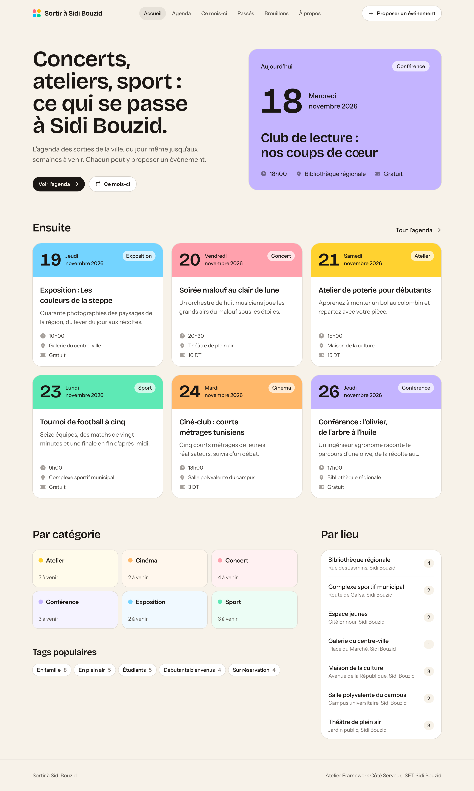
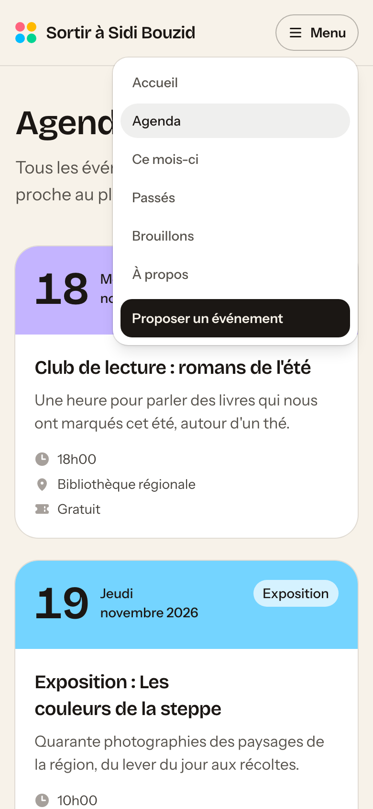

# Sortir à Sidi Bouzid

Un agenda des sorties de Sidi Bouzid : concerts, ateliers, sport, expositions, conférences et cinéma. On parcourt les événements par date, par catégorie, par lieu ou par tag, et on peut en proposer, en modifier, en publier ou en supprimer.

Projet de l'Atelier Framework Côté Serveur, ISET Sidi Bouzid. Laravel 13, Blade, Tailwind CSS 4, SQLite et Pest.



## Fonctionnalités

- Agenda des événements à venir, page des événements passés et page de chaque mois.
- Pages par catégorie, par lieu et par tag, liées par slug (`{category:slug}`, `{venue:slug}`, `{tag:slug}`).
- Page d'un événement à son slug (`/events/soiree-malouf-au-clair-de-lune`), avec les événements à venir de la même catégorie.
- Formulaire de création et de modification validé côté serveur, avec des messages d'erreur en français.
- Publication et dépublication (`PATCH`), page des brouillons, suppression avec confirmation.
- Accueil : le prochain événement en affiche, les suivants, et les compteurs par catégorie, lieu et tag calculés avec `withCount`.
- Un événement est « à venir » jusqu'à la fin de son jour de début, à l'heure de Tunis (`Africa/Tunis`).

## Routes disponibles

| Méthode | URI | Nom | Action |
|---|---|---|---|
| GET | `/` | `home` | `PageController@home` |
| GET | `/a-propos` | `about` | `PageController@about` |
| GET | `/events` | `events.index` | `EventController@index` |
| GET | `/events/passes` | `events.past` | `EventController@past` |
| GET | `/events/brouillons` | `events.drafts` | `EventController@drafts` |
| GET | `/events/mois/{year}/{month}` | `events.month` | `EventController@month` |
| GET | `/events/categorie/{category:slug}` | `events.category` | `EventController@byCategory` |
| GET | `/events/lieu/{venue:slug}` | `events.venue` | `EventController@byVenue` |
| GET | `/events/tag/{tag:slug}` | `events.tag` | `EventController@byTag` |
| GET | `/events/create` | `events.create` | `EventController@create` |
| POST | `/events` | `events.store` | `EventController@store` |
| GET | `/events/{event}` | `events.show` | `EventController@show` |
| GET | `/events/{event}/edit` | `events.edit` | `EventController@edit` |
| PUT | `/events/{event}` | `events.update` | `EventController@update` |
| DELETE | `/events/{event}` | `events.destroy` | `EventController@destroy` |
| PATCH | `/events/{event}/publication` | `events.publication` | `EventController@togglePublication` |

## Installation

Il faut PHP 8.4 ou plus récent, Composer et Node.js.

```bash
composer run setup
php artisan db:seed
php artisan serve
```

Le site est ensuite sur `http://localhost:8000`.

`composer run setup` installe les dépendances PHP, copie `.env.example` en `.env`, génère la clé de l'application, crée la base SQLite et ses tables, installe les dépendances JavaScript et compile le CSS. Les mêmes commandes marchent sous Windows, macOS et Linux.

## Données de démonstration

`php artisan db:seed` crée 6 catégories, 7 lieux, 5 tags et 25 événements inventés. Leurs dates sont calculées à partir du jour où la commande est lancée : des événements à venir sur 8 semaines, quelques événements passés et 3 brouillons. Avant une démonstration, relancez `php artisan migrate:fresh --seed` pour que les dates repartent du jour même.

Pour repartir de zéro : `php artisan migrate:fresh --seed`. Attention : cette commande vide la base avant de la remplir.

## Tests

```bash
php artisan test
```

Les tests figent la date avec `travelTo()` : ils donnent le même résultat quel que soit le jour où on les lance.

## Captures d'écran



